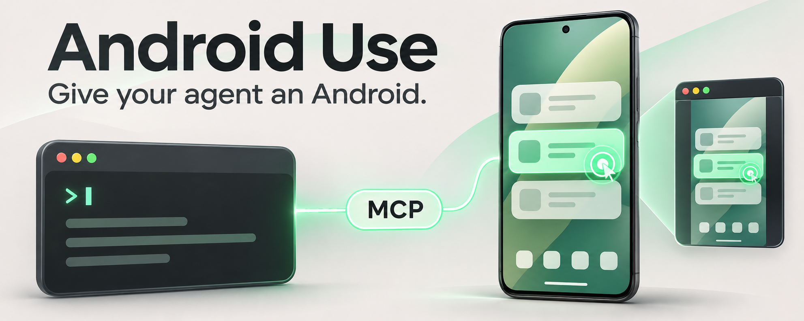
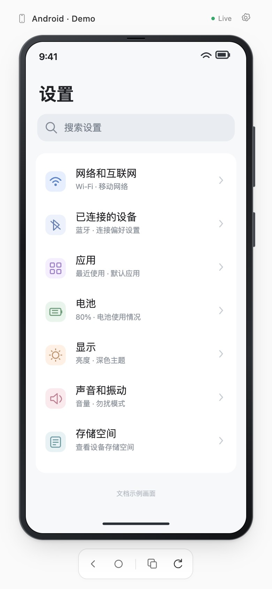
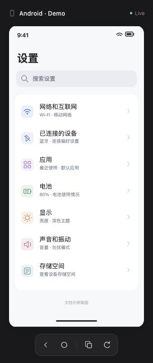

<div align="center">
  <h1></h1>
  <p>A standard MCP server for real Android interaction, with a live screen you can follow.</p>
  <p>
    <a href="https://github.com/JackCaow/android-use/actions/workflows/test.yml"></a>
    <a href="LICENSE"></a>
    <a href="pyproject.toml"></a>
    <a href="#mcp-client-support"></a>
  </p>
  <p><strong>English</strong> · <a href="README.zh-CN.md">简体中文</a></p>
  <p><a href="#quick-start"><strong>Get started →</strong></a> · <a href="docs/guide.md">Full guide</a> · <a href="docs/guide.md#other-mcp-clients">Client setup</a> · <a href="https://github.com/JackCaow/android-use/issues">Report an issue</a></p>
</div>

---

## From intent to interaction

Android Use gives an agent the tools to **read a screen, find a control, take an action, and check what happened** on your own Android phone or emulator. Connect through USB or an already-authorized wireless ADB connection, then work from your MCP client.

> “Open Settings and find Display & brightness. Read the current setting without changing it.”
>
> “Type `Hello, Android 🐻` into the focused field, verify the text, and leave it unsent.”

**No root, Appium, signing setup, or keyboard APK required.** The compiled live-screen UI is included; Node.js is only needed for frontend development.

## Built for agent workflows

| Capability | What it gives you |
| --- | --- |
| **Understand the screen** | Compact accessibility trees, screenshots, semantic selectors, and bounded waits. |
| **Act precisely** | Tap, long press, double tap, swipe, drag, launch apps, and use system buttons. |
| **Cut tool round trips** | Combine an action, a visible/gone condition, and an observation in one call. Search lists with bounded auto-scroll. |
| **Write real text** | Unicode and emoji input, replace or append, and native text readback. No implicit submission. |
| **Follow along live** | An independent H.264 stream in an MCP Apps view or local browser. Copy the displayed frame straight to the clipboard. |
| **Keep a clear handoff** | Pause reads, actions, and video for user authentication. Stop batches on unmet conditions; never automatically replay uncertain actions. |

## A screen you can follow

<table>
  <tr><th align="center">Light</th><th align="center">Dark</th></tr>
  <tr>
    <td align="center"></td>
    <td align="center"></td>
  </tr>
</table>

The actual screen UI, rendered with synthetic phone content for documentation. The theme follows your system. Tap and swipe in the preview, use Back or Home, or copy a PNG frame for a chat or document. [Live-screen guide →](docs/guide.md#live-screen)

## Quick start

### Let your agent install it

Paste this into an agent that can use your local terminal:

```text
Install and configure Android Use on this computer:
https://github.com/JackCaow/android-use

Read README.md, docs/guide.md, and skills/android-use/SKILL.md first.
Reuse existing installs and preserve uncommitted changes and other MCP servers.
Check dependencies, install missing ones from official sources, and set up the
current client's local stdio MCP connection. For Codex, build and install the plugin.
Discover devices, select the intended one, reuse a healthy service or start it once,
and actually verify ready=true. Open the live screen and check whether video works.
If new MCP tools are not loaded yet, use the CLI for setup and explain how to reload.
Perform the installation; do not only return instructions for me to follow.
Ask me to handle USB authorization, unlocking, and required system permissions.
Report what was installed, which checks passed, and any remaining steps.
```

For a client without terminal access, use the manual path below. [Detailed agent setup →](docs/guide.md#agent-led-installation)

### Or install manually

**1. Prepare the tools and clone.** Install [uv](https://docs.astral.sh/uv/getting-started/installation/), [ADB](https://developer.android.com/tools/releases/platform-tools), and [ffmpeg](https://ffmpeg.org/download.html). You also need Git; uv can provision Python 3.13.

```bash
git clone https://github.com/JackCaow/android-use.git
cd android-use
uv sync --frozen --python 3.13
```

**2. Connect your client.** Choose one route:

<details>
<summary><strong>Codex plugin</strong> — MCP tools, usage skill, and screen integration</summary>

Run from the repository root with the Codex CLI installed:

```bash
uv run python scripts/package.py
codex plugin marketplace add .
codex plugin add android-use@android-use-local
```

Packaging creates the `dist/android-use` directory used by the local marketplace. Open a new chat or reload tools, then enable Android Use. [Codex guide →](docs/guide.md#codex-plugin)

</details>

<details>
<summary><strong>Standard MCP</strong> — Claude Desktop, Cursor, VS Code, and other local stdio clients</summary>

No Codex CLI or plugin build is needed. For clients using `mcpServers`, merge this entry into the existing config and replace the repository path:

```json
{
  "mcpServers": {
    "android_use": {
      "command": "uv",
      "args": ["run", "--frozen", "--directory", "/absolute/path/android-use", "android-use-mcp"]
    }
  }
}
```

Cursor also uses `"type": "stdio"`. VS Code's `.vscode/mcp.json` uses a top-level `servers` object instead. See [client-specific paths and complete examples →](docs/guide.md#other-mcp-clients).

</details>

**3. Connect your phone.** Enable USB debugging, connect a data cable, approve the prompt on the phone, and keep it unlocked:

```bash
adb devices -l
uv run android-use setup '{"action":"status"}'
# Only if the control service is not running:
uv run android-use setup '{"action":"start"}'
uv run android-use ready
```

Look for **`ready=true`**. With multiple devices, [select the target explicitly](docs/guide.md#select-a-device). Then ask your agent:

> “Connect to my Android, verify READY, and open the live screen.”

[Full installation and troubleshooting →](docs/guide.md)

## MCP client support

**This is a standard local stdio MCP server**, built with the [official Python MCP SDK](https://github.com/modelcontextprotocol/python-sdk). The Codex plugin is an optional installation bundle.

| Connection | What to expect |
| --- | --- |
| **Local stdio MCP** | Phone-control tools and standard text/image responses. [Claude Desktop](docs/guide.md#claude-desktop), [Cursor](docs/guide.md#cursor), [VS Code / Copilot](docs/guide.md#vs-code--github-copilot), and other clients can use their local-command configuration. |
| **MCP Apps** | An embedded live-screen view when the host supports the extension. Layout and clipboard permissions depend on the host. |
| **Local browser** | Run `uv run android-use screen` and open the returned URL when an embedded view is unavailable. |

The preview URL is a private local video endpoint, **not a remote MCP endpoint**. Remote-only MCP clients cannot connect to this stdio service. Client configuration examples are documented; full end-to-end acceptance has not been completed for every client/version.

## A smaller loop, with explicit outcomes

```bash
# One call: tap → wait for a visible condition → return the tree.
# Replace these labels with ones from the current screen.
uv run android-use tap '{"selector":{"text":"Display"},"wait_for":{"selector":{"text_contains":"Brightness"},"timeout_seconds":5},"observe":"tree"}'

# Search a list with a swipe count and time budget; do not click the result.
uv run android-use scroll_until '{"selector":{"text":"Display"},"direction":"up","max_swipes":8,"timeout_seconds":20}'
```

Actions support optional postconditions. A timeout reports what happened and stops the batch; it does not repeat the action. Auto-scroll stops on a match, its limits, or repeated lack of progress. [Gestures, waits, batches, and all 22 tools →](docs/guide.md#cli-reference)

## Project status

**v0.3.0 · MIT · 69 Python tests · 6 browser tests.** Native device acceptance covers Android 16 on a Xiaomi 15 Ultra, including gesture events, delayed UI conditions, auto-scroll, and pause/resume. [Acceptance evidence and scope →](docs/validation.md)

Multi-touch, arbitrary gesture paths, fine-grained text selection, and custom-editor input fallbacks are not implemented. Device and app behavior varies; a matched UI condition is not proof of a completed business transaction. This project runs the control service and preview locally; tool results are handled by your chosen MCP client/model.

## Explore and contribute

| Start here | Go deeper |
| --- | --- |
| [English user guide](docs/guide.md) · [中文使用指南](docs/guide.zh-CN.md) | [Implementation notes — 中文](docs/architecture.md) |
| [Client configuration](docs/guide.md#other-mcp-clients) · [Troubleshooting](docs/guide.md#troubleshooting) | [Device acceptance records — 中文](docs/validation.md) |
| [Development and tests](docs/guide.md#development) · [Open an issue](https://github.com/JackCaow/android-use/issues) | [MIT license](LICENSE) · [Third-party notices](THIRD_PARTY_NOTICES.md) |

Bug reports and contributions are welcome. Include your host OS, Android version, client, and a minimal reproduction; remove device identifiers, access tokens, and private screen content.
