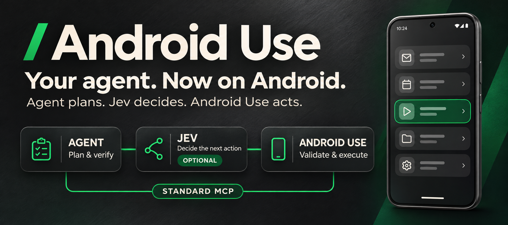
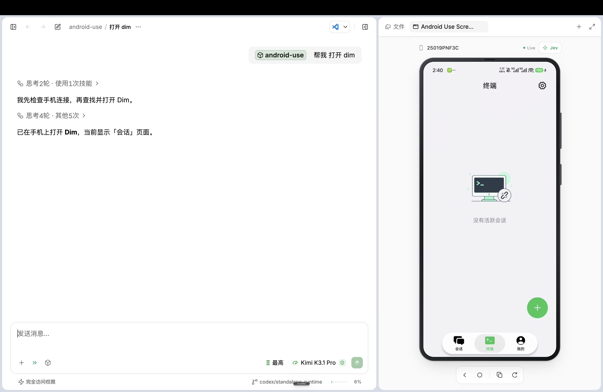
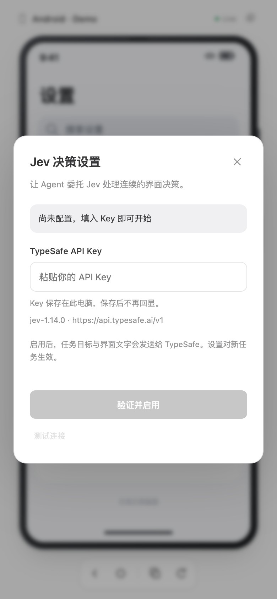

<div align="center">
  <h1></h1>
  <p><strong>让你的 Agent，真正操作 Android。</strong><br/>在 Dim Agent 中下达任务，实时画面跟随，可选 Jev 决策。</p>
  <p>
    <a href="https://github.com/arcships/android-use/actions/workflows/test.yml"></a>
    <a href="LICENSE"></a>
    <a href="pyproject.toml"></a>
    <a href="#mcp-客户端支持"></a>
  </p>
  <p><a href="README.md">English</a> · <strong>简体中文</strong></p>
  <p><a href="#快速开始"><strong>在 Dim Agent 中使用 →</strong></a> · <a href="https://github.com/arcships/android-use/releases/tag/v0.7.0">下载 v0.7.0</a> · <a href="#在屏幕中启用-jev">配置 Jev</a> · <a href="docs/guide.zh-CN.md">使用指南</a> · <a href="https://github.com/arcships/android-use/issues">反馈问题</a></p>
</div>

## 在 Dim Agent 中，直接完成 Android 任务

Android Use 把你自己的 Android 手机或模拟器接入 **Dim Agent**，也通过**标准 MCP**支持其他兼容客户端：读屏、定位、点击、输入、滚动，再核对结果。实时手机画面让过程看得见。

需要连续判断下一步时，可启用 **Jev**：Agent 保留规划与最终验收，Jev 选择下一步候选，Android Use 校验并执行。

> “打开设置，找到电池，读取当前使用情况。”
>
> “用我提供的文字填写资料，核对输入，保存本地草稿。”

**无需 root、Appium、签名配置或键盘 APK。** 已包含编译好的界面，通过 USB 或已授权的无线 ADB 连接。

## 按环境选择安装方式

**独立 runtime 不是必需项。** Agent 先检查用户环境，再自主选择合适的安装方式；已有健康安装直接复用。

| 用户环境 | 安装选择 |
| --- | --- |
| 已有正常工作的 Android Use / MCP | 复用现有入口并验证连接。 |
| 已有 Python/uv、ADB 和 ffmpeg | 使用源码安装，复用现有依赖。 |
| 缺少依赖，且有匹配、可校验的原生发行包 | 可选独立 runtime，减少逐项安装依赖。 |
| 离线、不支持的原生平台或尚无原生发行资产 | 选择可用的本地包或源码安装，明确缺失条件。 |

### 可选独立运行包 · v0.7.0

**Python、ADB、ffmpeg、实时界面和控制服务，打成一个原生运行包。** 轻量 Dim 插件首次自动安装；后续 MCP 连接立即使用已安装版本，并在后台检查更新。新包校验、握手通过后，下一次连接使用新版；失败保留旧版，回滚前也会重新验证。

**macOS OCR 是可选组件，默认包不带。** 控件树操作、Agent 看图和 Jev 均可独立使用。选择独立包的用户无需准备 Python、uv、Git、Node.js、JDK 或 Xcode 工具，公开发行包首次下载只使用系统基础工具。私有发行包自动安装支持 GitHub CLI 与私有令牌，也可用原生离线包省去此依赖。

v0.7.0 分别提供源码插件、轻量 Dim 插件和原生运行包，按用户环境选择；旧 v0.6.2 源码 ZIP 不含原生运行包。[安装、自动更新、可选 OCR 与回滚 →](docs/standalone.md#中文)

## 快速开始

### 在 Dim Agent 中使用

**在连接 Android 手机的电脑上打开 Dim Agent 桌面端。** 安装一次 Android Use，之后在聊天中描述任务，在右侧手机画面跟随执行过程。Jev 可选；不配置额外模型 Key，也能由当前 Agent 决策。

**1. 连接手机。** 开启开发者选项和 USB 调试，插入数据线，在手机上接受调试授权并保持解锁。ADB 需要运行在 Dim 实际执行命令的电脑上；如果使用远程会话，手机应连接到那台执行主机。

**2. 让 Dim Agent 完成安装配置。** 将下面整段发到有本机终端权限的聊天中：

```text
请在这台电脑上为 Dim Agent 安装并配置 Android Use：
https://github.com/arcships/android-use

先阅读 README.md、docs/guide.zh-CN.md 和 skills/android-use/SKILL.md。
复用已有安装，保留其他 MCP 服务和未提交改动。
检查 Python/uv、ADB、ffmpeg、系统架构、网络与可用发行资产，自主选择源码安装或可选独立包。
不要为了使用 runtime 迁移已有健康安装，先读 docs/standalone.md。
源码方式用 scripts/install.py install --source .；独立包核对平台与发行 SHA256，均使用返回的固定入口。
把返回的 mcp_config 注册为 Dim 的本地 stdio MCP，名称 android_use；
使用 Dim 的 MCP 管理或 dim mcp add，先检查已有注册，避免重复配置。
发现设备，明确选择我的目标手机，先调用 aua_setup(action="status")，
仅在服务缺失时启动，再实际验证 aua_ready 返回 ready=true。
调用 aua_screen 在 Dim 右侧打开实时手机画面，并检查画面有更新。
工具尚未加载时，重载 MCP 或新建聊天，再次核对工具是否可用。
请实际执行安装并报告结果；手机授权和解锁由我处理，暂不启用 Jev。
```

<details>
<summary>手动配置 Dim：使用固定 MCP 入口</summary>

已有依赖可使用源码方式；缺少依赖时，可按环境选择[独立运行包](docs/standalone.md#中文)。两种方式均返回固定 `mcp_config`。选择源码方式时，准备依赖并[克隆仓库](#或者手动安装)，在仓库根目录执行：

```bash
uv run --no-project --python 3.13 python scripts/install.py install --source .
```

返回的 JSON 包含 `mcp_config.command` 和 `mcp_config.args`。在 Dim 的 **MCP 管理**中添加**本地 stdio** 服务，名称填 `android_use`，命令与参数按返回值逐项填写，保持参数顺序。安装器会创建独立运行时，真实 MCP 握手通过后才切换版本。

已安装 Dim CLI 时，将返回的命令和**全部参数**依次注册。下方示例是独立包的 macOS/Linux 入口，启动器路径按安装结果替换：

```bash
dim mcp add --scope user android_use -- /bin/sh "/absolute/path/runtime/launcher.sh" auto-serve
dim mcp test android_use --json
```

Windows 和源码安装器请使用各自返回的 `mcp_config`，不要照抄此参数。[原生包安装 →](docs/standalone.md#offlinemanual-native-package)

检查 MCP 测试返回的工具列表是否非空；部分 Dim CLI 版本会返回 `success=true`、`tools=[]`，不能据此判断工具已加载。请在新的 Dim 聊天中实际调用 `aua_setup` 和 `aua_ready`。已有 Android Use 注册时，先检查原条目再配置。[升级与回退 →](docs/upgrading.md#中文)

</details>

**3. 发出第一个任务。** 工具加载完成后，在聊天中说：

> 使用 Android Use 检查手机 READY，打开实时画面，再进入设置读取电池电量，不修改任何设置。

Dim Agent 会调用 Android 工具，通过 `aua_screen` 在桌面端右侧打开画面。你可以旁观，也可以点击、滑动、返回、回到主屏或复制画面。宿主不能内嵌时，让 Agent 在同一电脑的浏览器中打开返回的本机预览 URL。

| 在 Dim Agent 中做什么 | 可以直接这样说 |
| --- | --- |
| 读屏与导航 | “打开设置，找到电池，读取当前使用情况。” |
| 填写草稿 | “输入我提供的文字，回读核对，保存本地草稿。” |
| 跨 App 比价 | “在美团和淘宝比较同一款饮品的外送到手价，计入配送和打包费，只报告价格，不下单。” |
| Agent + Jev 协作 | “短流程的下一步判断交给 Jev，规划和异常恢复由 Agent 负责，最后独立核对结果。” |

**可选：开启 Jev。** 在手机画面中点击 **Jev**，填写 TypeSafe API Key，再点**验证并启用**，新任务立即生效，无需配置 `TEXT_MODEL_*`。Dim Agent 继续负责规划、编写文本和最终验收。[Jev 设置与发送数据说明 →](#在屏幕中启用-jev)

## 像拿着手机一样，看见每一步



在 Dim Agent 中描述任务，旁边的实时手机画面展示执行过程。屏幕内支持点击和滑动，工具栏支持返回、Home 与 PNG 画面复制。[实时屏幕指南 →](docs/guide.zh-CN.md#实时屏幕与图片复制)

## Agent 规划，Jev 决策，Android Use 执行

| 负责方 | 职责 |
| --- | --- |
| **你的 Agent** | 理解需求、规划子目标、编写文本、恢复和最终验收。 |
| **Jev · 可选** | 根据当前界面，选择代码提供的下一步候选。 |
| **Android Use** | 读屏、校验范围与过期状态、执行原生动作、控制预算和暂停。 |

已知路径使用 `batch`、动作加等待或 `scroll_until`。下一步依赖新界面的短流程可交给 `aua_execute_goal`。没有 TypeSafe Key 时自动使用宿主决策模式：由你的 Agent 通过 `aua_goal_decide` 逐步选择代码生成的候选，Android Use 照样做过期、效果与防重放检查。遇到不确定情况就带着动作账本和安全上下文交回 Agent。[分工、边界与示例 →](docs/jev.zh-CN.md)

## 在屏幕中启用 Jev

1. 打开手机预览，点击右上角**Jev 按钮**。
2. 粘贴 **TypeSafe API Key**。
3. 点击**验证并启用**。

服务端验证连接，将 Key 保存在这台电脑；新任务立即生效。也可在同一面板测试连接、停用或移除已保存的 Key。**Jev 默认关闭。**[详细配置与高级环境变量方式 →](docs/jev.zh-CN.md#配置)

<details>
<summary>查看 Jev 设置界面</summary>



启用后，子目标、可见界面文字和允许输入值会发送给 TypeSafe 进行决策。保存的 Key 不回传界面。只有单独勾选「允许发送截图（视觉定位）」后，视觉定位（`aua_locate`）才会发送截图。

</details>

## 面向真实操作

| 能力 | 你能得到什么 |
| --- | --- |
| **理解界面** | 控件树、截图、语义选择器与有界等待。 |
| **精确操作** | 点击、长按、双击、滑动、拖拽、启动 App 与系统按钮。 |
| **补上控件树看不到的** | 可选 Jev Box 定位 Canvas、图片和无标签目标；视觉点击先复核像素，只点一次。 |
| **减少往返** | 动作、等待、观察合并；自动滚动按次数和时间停止。 |
| **输入与核对** | 中文、emoji、替换/追加和原生回读；稳定输入框可一次决策完成聚焦→输入→回读。 |
| **清楚交接控制** | 认证由用户接管；保留 partial/uncertain 动作账本，不自动重放。 |

## 其他客户端与手动安装

### 让 Agent 自己安装

将下面整段发送给**能使用本机终端的 agent**：

```text
请在我的电脑上安装并配置 Android Use：
https://github.com/arcships/android-use

先阅读 README.md、docs/guide.zh-CN.md 和 skills/android-use/SKILL.md。
复用已有安装，保留未提交修改和其他 MCP 服务配置。
检查依赖，从官方来源补齐缺项，为当前客户端配置本地 stdio MCP；
如果使用 Codex，用 scripts/install.py 安装固定入口插件，先检查旧注册冲突；其他客户端使用安装器返回的稳定 MCP 配置。
发现设备、明确选择目标，复用健康服务或启动一次，实际验证 ready=true。
打开实时屏幕并检查画面；工具尚未加载时先用 CLI 配置，再说明如何重新加载。
请实际完成安装，不要只给我手动操作教程。
USB 授权、解锁和必要系统权限由我本人在手机上处理。
最后报告安装结果、已通过的检查和剩余步骤。
```

客户端不能使用终端时，按下方步骤手动安装。[Agent 安装详细流程 →](docs/guide.zh-CN.md#让-agent-自动安装)

### 或者手动安装

**1. 准备工具并克隆仓库。** 安装 [uv](https://docs.astral.sh/uv/getting-started/installation/)、[ADB](https://developer.android.com/tools/releases/platform-tools)、[ffmpeg](https://ffmpeg.org/download.html) 和 Git；uv 可按需安装 Python 3.13。

```bash
git clone https://github.com/arcships/android-use.git
cd android-use
uv sync --frozen --python 3.13
```

**2. 连接客户端。** 选择一种方式：

<details>
<summary><strong>Codex 插件</strong> — MCP 工具、使用技能与实时屏幕集成</summary>

预打包 ZIP 按[发行包安装步骤](docs/guide.zh-CN.md#安装发行包-zip)操作；从源码安装时，先安装 Codex CLI，再在仓库根目录运行：

```bash
uv run --no-project --python 3.13 python scripts/install.py doctor
uv run --no-project --python 3.13 python scripts/install.py install --source . --codex
```

**v0.6.2 已包含：** 完整运行时复制到固定管理目录，真实 MCP 握手通过才切换；启动入口不依赖版本缓存和解压目录。已有安装需显式加 `--migrate-codex`，保留 Key 与原设置，并检查同名配置冲突。完成后重载工具。[升级、迁移与回退 →](docs/upgrading.md#中文)

</details>

<details>
<summary><strong>标准 MCP</strong> — Claude Desktop、Cursor、VS Code 及其他本地 stdio 客户端</summary>

无需安装 Codex CLI 或打包插件。使用 `mcpServers` 的客户端可合并下方配置，并替换仓库绝对路径：

```json
{
  "mcpServers": {
    "android_use": {
      "command": "uv",
      "args": ["run", "--frozen", "--directory", "/absolute/path/android-use", "android-use-mcp"]
    }
  }
}
```

Cursor 还需 `"type": "stdio"`；VS Code 的 `.vscode/mcp.json` 顶层字段是 `servers`。参见[各客户端的文件位置与完整配置 →](docs/guide.zh-CN.md#其他-mcp-客户端)。

</details>

**3. 连接手机。** 开启 USB 调试，使用数据线连接，在手机上接受授权，并保持亮屏、解锁：

```bash
adb devices -l
uv run android-use setup '{"action":"status"}'
# 仅当控制服务未启动时执行：
uv run android-use setup '{"action":"start"}'
uv run android-use ready
```

实际返回 **`ready=true`** 后才代表控制通道就绪。多设备时[明确选择目标](docs/guide.zh-CN.md#3-多设备或切换-usb--无线连接)，然后对 agent 说：

> “连接我的 Android，验证 READY，再打开实时手机屏幕。”

[完整安装与故障排查 →](docs/guide.zh-CN.md)

## MCP 客户端支持

核心是基于[官方 Python MCP SDK](https://github.com/modelcontextprotocol/python-sdk)的**标准本地 stdio MCP Server**。Codex 插件只是可选的安装封装。

| 接入方式 | 能力与要求 |
| --- | --- |
| **Dim Agent 桌面端** | 本地 stdio 工具、右侧实时手机画面，以及可选 Agent + Jev 协作。[开始使用](#快速开始)。 |
| **本地 stdio MCP** | 手机控制工具及标准文本 / 图片返回。Claude Desktop、Cursor、VS Code / Copilot 等使用各自的[本地命令配置](docs/guide.zh-CN.md#其他-mcp-客户端)。 |
| **MCP Apps** | 宿主支持该扩展时，可内嵌实时屏幕；布局和剪贴板权限取决于宿主。 |
| **本机浏览器** | 无内嵌界面时，执行 `uv run android-use screen`，打开返回的本机 URL。 |

视频预览 URL 是私有的本机画面地址，**不是远程 MCP 端点**；仅支持远程 URL 的客户端不能直接接入本版。各客户端已有配置示例，但尚未对所有客户端 / 版本完成端到端验收。

v0.5.1：支持的设备连续录屏，旧系统换段复用连接与解码器；短暂恢复保留画面。[恢复行为与排查说明 →](docs/guide.zh-CN.md#实时屏幕与图片复制)。

## 更短的操作循环，明确的执行结果

```bash
# 一次调用：点击 → 等待可见条件 → 返回控件树。
# 标签需按当前页面填写。
uv run android-use tap '{"selector":{"text":"显示与亮度"},"wait_for":{"selector":{"text_contains":"亮度"},"timeout_seconds":5},"observe":"tree"}'

# 有次数和时间上限的列表查找；找到后不自动点击。
uv run android-use scroll_until '{"selector":{"text":"显示与亮度"},"direction":"up","max_swipes":8,"timeout_seconds":20}'
```

动作可携带后置条件；等待超时会报告结果并停止批处理，不重复执行动作。自动滚动在找到目标、达到上限或连续无进展时停止。[手势、等待、批处理与原有工具 →](docs/guide.zh-CN.md#cli-使用)

可选决策集成与原有工具配合使用：[Agent + Jev 配置、分工和对比测试 →](docs/jev.zh-CN.md)。

## 可选交互变化（源码更新）

手势或局部目标可显式传 `variation`：限定范围内变化等待、选择器落点和滑动参数，支持固定种子复现。明确坐标和文本保持精确；新增等待后检查页面，继续遵守预算与不重放规则。默认行为不变，不承诺防检测。[参数、审计与边界 →](docs/interaction-variation.md#中文)

源码及 v0.7.0 发行包统一托管于 [arcships/android-use](https://github.com/arcships/android-use)。

## v0.6.0：无 Key 决策与视觉定位

没有 TypeSafe Key 也能用 `aua_execute_goal`：由你的 Agent 通过 `aua_goal_decide` 逐步选择代码生成的候选，照样做过期、效果和防重放检查。使用 Jev 时，已核对的 emoji 输入不再重复输入，每步读屏更少，目标判断头可在目标已达成时停止。新增可选 Jev Box（`aua_locate`、点击的 `visual`），定位 Canvas、图片和无标签目标；只有勾选「允许发送截图（视觉定位）」后才发送截图。不支持 `screenrecord` 的手机会直接说明，不再反复重试预览。v0.6.1：Box 框住多个树中文字标签时返回 `ambiguous` 和 `tree_candidates`，不再给出点击点；Box 用于图标、图片和 Canvas，文字请用选择器。[宿主决策与 Box →](docs/jev.zh-CN.md)

## v0.5.2：修复预览重连

闲置时保留预览入口，MCP 读图可恢复已退出的服务；收到新画面后才提示重连成功。Jev 设置入口改为带文字的简洁星标按钮。[恢复行为、验收与边界 →](docs/preview-reconnection.md)

## v0.5.1：连续实时预览

支持的设备不再每 170 秒重启录屏；旧系统分段共用一条 ADB 管道和一个解码器。短暂恢复保留画面，显示信息读取失败时只暂停控制，不中断健康视频；认证接管和真实掉线仍清屏。

Android 16 真机 **190 秒连续采集通过**，始终一个编码器/连接/解码器，最长采样间隔 1.422 秒。模拟器的偶发停顿仍待定位；兼容测试保留了脚本人为注入恢复状态导致的失败记录。[验收、失败与边界 →](docs/preview-continuity.md)

## v0.5.0：动作防重放与自动 OCR

**已纳入 v0.5.0 插件 ZIP。** 保留全部 MCP 工具，新增按当前页面自动选择 AX / 本地 OCR 的只读 `aua_read_fields`。树有目标文字就直接用树，缺少文字或指定标签时才截取 ROI，在本机识别，再由 Jev 一次判断多项字段。动作执行增加效果等待和重复动作拦截；金额保留负号、千位分隔及币种。

开发真机验收中，美团 AX 与 OCR 均得到 **19 + 1.5 + 2.4 = 22.9 元**；淘宝从空语义树自动走 OCR，得到 **24 + 1.5 + 2.3 − 6 = 21.8 元**。Agent 独立核对画面，临时商品已清空，未下单付款。保留了 ROI 不合适、动画干扰和字段缺失等失败；这不是整体速度对照或最低价证明。后续守卫修正仅做离线回归，按用户要求未再操作手机。

v0.5.0 通过 **277 项 Python 测试、17 项界面测试**。内置 OCR 目前需要 macOS 与 Xcode Command Line Tools；视觉自动定位和点击仍未实现。更新后重新连接 MCP。

[字段工具与参数](docs/jev.zh-CN.md#自动只读-ocr) · [本轮验收与保留失败](docs/benchmarks/real-app-ocr-v6.md) · [已实现边界与后续方案](docs/visual-routing.zh-CN.md)

## 有数据，也说明边界

已记录 **18 次源码对照**和 **12 次实时 Agent / Agent + Jev 对比**；实时两组各完成 6/6。动态流程减少了宿主往返，已知批处理路径没有提速。采样复用减少重复查询，输入宏减少决策，但该轮未额外降低耗时。[方法、原始数据与保留的失败记录 →](docs/benchmarks/optimizations-v4.md)


## 项目状态

**v0.7.0 · MIT · 481 项 Python 测试 · 24 项浏览器测试。** 原生安装、升级和回滚在 macOS ARM64/Intel 各通过 15 项，Linux x86_64/Windows x86_64 各通过 13 项。这些包验收不操作手机、不调用模型；历史 Android 16 真机与模拟器验收分开记录。[验证记录](docs/validation.md)。

多指手势、任意轨迹、精细文本选区及自绘编辑器输入兜底尚未实现。UI 条件满足仅证明该条件，Agent 仍需验收业务结果。控制和预览运行于本机，工具结果由你选择的客户端与模型处理。

Android Use 由 **Archship** 维护，源码采用 MIT；运行包依赖保留各自协议。[协议审计与随包声明 →](docs/license-audit.md#中文)

## 致谢

感谢 [iPhone Use](https://github.com/zhongerxin/iPhone-use) 的作者与贡献者，为 Android Use 在手机 Agent 交互、引导式安装和实时画面方面带来的启发。

## 文档与贡献

| 开始使用 | 深入了解 |
| --- | --- |
| [中文使用指南](docs/guide.zh-CN.md) · [English guide](docs/guide.md) | [实现说明](docs/architecture.md) |
| [客户端配置](docs/guide.zh-CN.md#其他-mcp-客户端) · [故障排查](docs/guide.zh-CN.md#常见问题) | [真机验收记录](docs/validation.md) |
| [开发与测试](docs/guide.zh-CN.md#开发与验证) · [提交问题](https://github.com/arcships/android-use/issues) | [MIT 许可证](LICENSE) · [第三方声明](THIRD_PARTY_NOTICES.md) |

欢迎反馈问题与贡献代码。请提供电脑系统、Android 版本、客户端和最小复现步骤，并移除设备标识、访问令牌和私人画面。
