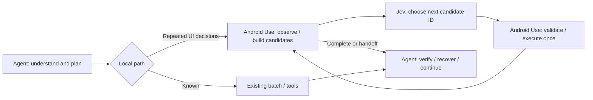

# Agent + Jev decision integration (experimental, available since v0.4.0)

**English** · [简体中文](jev.zh-CN.md) · [Project home](../README.md)

`aua_execute_goal` runs a bounded local goal through TypeSafe Jev. All original MCP tools and arguments remain available. It is disabled by default and **included in the v0.4.0 ZIP**; v0.3.0 users must update.

Inspired by [browser-use/jev-ultrafast](https://github.com/browser-use/jev-ultrafast), this independent Android implementation observes accessibility trees, builds code-owned action candidates, asks Jev to select an ID, executes it once, then observes again. It does not install the browser project or need a text-generating model at runtime.

## No key: host decider

`decider` defaults to `auto`: Jev when it is enabled with a key, otherwise `host`. Force either with `"decider": "jev"` or `"decider": "host"`. In host mode nothing leaves your computer:

1. `aua_execute_goal` returns `status=decision_required` with the compact `state`, the `options` (candidate IDs plus `DONE` / `BLOCKED`) and a one-time `token`.
2. Your Agent calls `aua_goal_decide` with `{"token": ..., "choice": "a3"}`.
3. Android Use reads the UI again. If it changed, the choice is discarded and a fresh decision returns with `previous_choice_stale=true`. Otherwise the candidate runs once, its effect is checked, and the next decision, completion or handoff is returned.

Tokens are single-use, kept in memory for 5 idle minutes and tied to the running MCP server process; the one-shot CLI cannot resume them. An unknown option ID keeps the token. `timeout_seconds` counts device time only, so Agent thinking time does not spend it. Host mode trades round trips for zero setup; Jev remains the faster path for long decision loops.

## Agent + Jev

Routing prioritizes end-to-end completion speed, success rate and fewer host-model round trips. Jev token cost is treated as secondary telemetry, not a routing constraint. Delegate coherent local decision loops and reuse safe returned observations; keep host planning, recovery and business verification.

Your existing host Agent understands the request, plans subgoals, composes exact text, opens the intended app, and verifies business outcomes. It can delegate repeated **next-action decisions** inside a short local goal to `aua_execute_goal`. Android Use observes the UI and creates candidates; Jev returns a candidate ID and probabilities; Android Use validates and executes the selected action once. On completion or handoff, control returns to the same Agent. Long tasks use several subgoals.



Use ordinary tools for a known path; use Jev where the Agent would otherwise read the tree and decide repeatedly. The intended efficiency comparison is **Agent-only vs the same Agent + Jev**, including planning, handoff/recovery and final verification. The earlier deterministic-tools comparison measures execution overhead only. Normal hybrid use needs only your existing Agent and the TypeSafe key; `TEXT_MODEL_*` is optional configuration for a separate API-based benchmark, not an installation requirement.

[Latest performance comparison and raw records →](benchmarks/optimizations-v4.md). Run `scripts/benchmark_agent.py` with the same `uv run --env-file .env --frozen python` prefix, `--serial <device>` and `--repeats 3`: the current Agent chooses ordinary tools or Jev decisions, handles recovery and verifies results. The driver measures host waiting separately. Host token charges remain unknown when the host does not expose per-task billing.

<a id="structured-decisions-and-field-judgments-source-update-unreleased"></a>

## Structured decisions and field judgments (v0.5.0)

The source checkout now sends a compact semantic UI table instead of the first 120 raw nodes. Candidate targets remain represented even when they occur later in the tree. Empty layout properties and repeated labels are removed; unlabeled wrappers with actionable children no longer compete with those children. If needed, text summaries and non-target context shrink further. Exact supplied input values are never truncated. The full local tree still validates actions.

Each action cycle asks an **operation Choice plus compatible target Choices in one request**. Only the selected operation's target is consumed; unused heads cannot trigger actions. Probability and margin gates use the weakest selected head. This reorganizes one request, not a claim of fewer requests by itself.

`aua_read_fields` is a new **read-only standard MCP tool**, also available as CLI `read_fields`. It supports up to 12 requested `money`, `text`, or `choice` fields. Code finds observed spans; Jev selects their roles; code copies the exact value and parses money with `Decimal`. Every question has a `NONE` option. All field questions share one request.

```json
{
  "package": "com.example.shop",
  "currency": "CNY",
  "source": "auto",
  "expected_labels": ["合计", "打包费"],
  "fields": [
    {"name": "items", "instructions": "Select the purchased item subtotal before coupons."},
    {"name": "packing", "instructions": "Select the charged packaging fee."},
    {"name": "delivery", "instructions": "Select current charged delivery, not the old price."},
    {"name": "total", "instructions": "Select the actual checkout payable total."}
  ],
  "sum_check": {"total": "total", "add": ["items", "packing", "delivery"]}
}
```

Use the actual foreground package and include every applicable charge/discount in the check. `sum_check` computes **sum(add) − sum(subtract) = total** exactly, within one currency. A printed negative discount can go in `add`; a positive discount magnitude can go in `subtract`. Do not apply both conventions to the same discount. Missing fields or mismatches mark all participating fields unaccepted while retaining their evidence for review. An arithmetic match does not prove semantic correctness.

Optional `region={x,y,width,height}` selects text nodes by their centers in **Android display pixels**, reducing irrelevant banners/address text. Text is grouped by visual rows before judgment. Read-only validation compares current context and the same region's text rows after inference; it ignores empty-layout animation but rejects changed evidence. Authentication/lock/pause checks still cover the full page. Actions retain their stricter tree/geometry checks.

AX-poor pages can now use automatic local OCR of the current device ROI. Agent-supplied `evidence_text` remains supported, always marked `caller_provided_text`, `source_verified_on_device=false`, and `freshness=unchecked`; the Agent owns its freshness and correctness. Automatic visual grounding and clicks are not implemented.

Check `fields.*.accepted`, `checks`, and provenance. `status=judged`, `all_fields_accepted=true` and `source_verified_on_device=true` **never mean business success**; `verified` remains false. Missing/low-probability answers return no value. A sum conflict preserves selected values with `review_reason=sum_check_failed`. Error telemetry is retained under `error.metrics` when inference had started.

[Automatic OCR acceptance and failures](benchmarks/real-app-ocr-v6.md) · [Earlier Agent-supplied OCR records](benchmarks/real-app-jev-v5.md). Development checkout totals were 22.9 / 21.8 yuan for different drinks; these are not a cheapest-price or whole-task performance comparison. These updates are included in the v0.5.0 ZIP.

<a id="automatic-read-only-ocr-source-update-unreleased"></a>

## Automatic read-only OCR

`aua_read_fields` / CLI `read_fields` defaults to `source=auto`: the selected region uses AX when it has text, every requested `expected_labels` substring, and at least one amount candidate for money questions. Otherwise it switches to local OCR **before the first Jev request**. This deterministic filter does not establish that all task evidence exists. Use `source=tree` to disable OCR or `source=screen_ocr` to force it. Up to 12 expected labels are supported. Choose a bill `region` from the actual screen and supply precise field roles.

The built-in provider currently requires **macOS Vision and Xcode Command Line Tools** (`xcode-select --install` if missing). Dependencies are not installed automatically. On Linux/Windows, AX and existing tools remain usable; OCR returns `ocr_unavailable` for Agent recovery or checked caller text. Those OCR platforms are not implemented.

The screenshot is cropped locally. OCR returns text, block boxes and scores; visual rows become closed-set field candidates. Images are not uploaded to TypeSafe; **recognized text and field questions are sent**. ROI and optional `ocr_masks` use Android display pixels. Up to 8 masks must fit entirely inside the ROI and their summed area cannot exceed 20%. Masks are whitened before recognition and hashing; masked content cannot supply evidence. Exclude irrelevant private data with a narrow ROI. Never mask prices, dialogs or business outcomes.

After inference, another capture must have exactly the same ROI pixels outside explicit masks. Changes discard all fields; no uncalibrated fuzzy matching is used. Foreground, Activity, viewport, pause, lock and detectable authentication are rechecked. This cannot prove every custom overlay/authentication prompt was detected. Results include `source=device_screen_ocr`, `freshness=roi_pixels_checked`, and a `frame` ROI, digest, timestamp, masks and diagnostic ID. That ID is **not** an action `observation_id`. `source_verified_on_device=true` establishes origin, not OCR accuracy or business success; `verified` remains false.

`min_ocr_confidence` defaults to 0, retaining the provider score as uncalibrated telemetry. Callers may set a validated floor for money/text candidates. Choice classifications have no individual amount-candidate OCR score. Jev probability/margin, OCR scores, arithmetic and Agent verification are separate checks. OCR does not establish strikethrough styling (`style=unknown`); position alone is not proof of the current price.

The overall deadline defaults to 20 seconds, maximum 60. Cold helper compilation gets at most 15 remaining seconds, recognition 5, and Jev 8. Expired judgments are discarded. In-flight device RPCs retain their existing timeout limits and may overrun the remaining budget. Timings are returned separately and failed inference keeps usage telemetry.

**Compatibility changes:** sum checks require a resolved, shared currency for every amount. Declare `currency` for ambiguous `¥` / `$`; supported declarations are CNY, JPY, USD, HKD, EUR, GBP, CAD and AUD. Original spans are preserved; Unicode signs, comma grouping and dot decimals (including fullwidth equivalents) normalize into Decimal. Other locale formats are not supported. Put signed negative discounts in `add`; `subtract` only accepts positive discount magnitudes (`negative_subtrahend` otherwise). Caller `evidence_text` cannot also specify a device `source`, `region`, or `ocr_masks`, preventing false provenance claims.

`aua_execute_goal` adds `effect_timeout_seconds` (default 1; 0.1–3 seconds). After an acknowledged tap/input it only observes until nonempty semantic evidence changes or the completion condition is met. No effect hands off as `uncertain_effect`; revisiting the same consumed state/action within this call hands off as `duplicate_action`. Geometry animation and transient empty trees do not count as effects. ACK stays recorded as executed, not business success. Wait/list-swipe no-progress limits remain. This is not cross-call idempotency: inspect the returned ledger rather than resubmitting a whole goal.

## Visual location with Jev Box (opt-in screenshots)

Some targets have no usable tree node: canvas and game UIs, WebView images, unlabeled icons. `aua_locate` asks Jev Box (`jev-1.14` or newer) where the described element is, and `aua_tap` / `aua_long_press` / `aua_double_tap` accept `visual` with the same arguments in place of `selector` or `x`/`y`.

This is the only feature that **uploads a screenshot**, so it has its own opt-in, separate from enabling Jev and **off by default**. Turn on 「允许发送截图（视觉定位）」 in the Jev settings panel, or set `ANDROID_USE_JEV_IMAGES=1` for the server process. A saved choice overrides the environment. Otherwise both calls return `jev_images_disabled` before reading the phone.

```json
{"package": "com.example.shop", "description": "the cart icon at the top right",
 "region": {"x": 0, "y": 192, "width": 1080, "height": 2016}}
```

- One request carries one JPEG of `region` (default: full display), scaled to 280–1568 px per side, with three questions: Noul presence, a Choice of none/one/several, and a Box. It costs about 3,900 input tokens (≈$0.00016) and about 0.4 s of model time. If the first answer is uncertain (presence between 0.3 and the threshold, or low confidence) on a downscaled image, it asks once more on a native-resolution crop of at least 560 px around the first box. `refined` reports that crop window, and `model_calls` becomes 2.
- `status` is `located` only when presence ≥ `min_presence` (default 0.7), exactly one match, and box confidence ≥ `min_confidence` (default 0.5). Otherwise it is `not_found`, `ambiguous`, `low_confidence`, or `masked` (the box center falls in a mask). `box` is `[x, y, width, height]` and `tap` is `[x, y]`, both in display pixels. `tap` is null unless the status is `located`.
- Up to 8 `masks` are whitened before upload. Exclude the status bar (notifications) with `region` when it is not needed.
- Nothing is captured on a paused device, a visible password field, or an OTP/PIN prompt in the tree. A secure window (all-black capture) returns `screen_capture_blocked` without a model call. Other custom authentication drawn only in pixels cannot be detected; pause first.
- A visual tap locates, reads the context again, captures again, and compares pixels around the padded box. More than 1% changed pixels returns `stale_visual_target`. It then taps the box center **once** and supports `wait_for`/`observe`. Unconfirmed targets return `visual_target_not_found`, `ambiguous_target` or `visual_low_confidence` with the locate result, and nothing is tapped. Visual taps are rejected in `batch`.
- A located box is a model judgment, not verification. Prefer tree selectors whenever they work, and verify the outcome from the device.

## Configure

### Recommended: screen settings

Open the live phone view, click the **Jev** button, paste your TypeSafe API Key, and choose **验证并启用** (Verify & enable). This makes one fixed connection-test request without reading phone UI, then saves and enables the key for new tasks. You can test the saved connection, disable Jev, or remove the locally saved key in the same panel. The key field clears after saving and when closing the dialog.

Settings are shared by the local browser, native MCP App and later CLI/MCP calls. They take effect for **new tasks without restarting the server**; an in-progress bounded goal keeps the configuration it started with. The local file is `~/.local/share/android-use/jev.json` (or `ANDROID_USE_STATE_DIR/jev.json`), written atomically with POSIX mode `0600`. It is never included in packages or returned to the UI.

Explicit local enable/disable settings override `ANDROID_USE_JEV_ENABLED`. A saved local key takes priority over `TYPESAFE_API_KEY`; removing it leaves Jev disabled even if an environment key remains available. Provider/model overrides still come from the environment and are displayed in settings.

### Advanced: environment configuration

The UI route needs no manual `.env` edits. Existing environment-based setups remain supported.

Copy `.env.example` to `.env`, set `ANDROID_USE_JEV_ENABLED=1` and `TYPESAFE_API_KEY`. Keep the file private; it is ignored by Git. Never paste keys into chats or tool arguments. Start/verify the normal Android service, launch the intended app, and keep it unlocked. The goal executor does not start the phone service automatically.

Pass these variables to the MCP server process. A plugin or MCP host does **not automatically load** the repository's `.env`. Merge this source-based stdio configuration into your client's existing settings, replace the absolute paths, and reconnect:

```json
{
  "mcpServers": {
    "android-use": {
      "command": "uv",
      "args": ["run", "--env-file", "/absolute/path/android-use/.env", "--frozen", "--directory", "/absolute/path/android-use", "android-use-mcp"]
    }
  }
}
```

Alternatively inject environment variables through your host's secret manager. The default is pinned `jev-1.14.0` at `https://api.typesafe.ai/v1/systemone`. `TYPESAFE_MODEL` / `TYPESAFE_BASE_URL` override these. A custom URL receives the key: use a trusted provider only. HTTPS is required except for loopback test servers. No redirects, implicit paid-request retries or silent model fallback.

## Use

Call `aua_execute_goal` with observed package/selector facts:

```json
{
  "goal": "Open Profile, set Name to Android helper, then Apply draft to save locally.",
  "package": "your.verified.app.package",
  "texts": ["Android helper"],
  "completion": {"text": "DRAFT=Android helper"},
  "max_steps": 8,
  "max_model_calls": 16,
  "timeout_seconds": 20.0
}
```

CLI supports the same JSON: `uv run --env-file .env --frozen android-use --serial <device> execute_goal '<JSON>'`.

`texts` is an allowlist of exact input values; Jev chooses a value, it cannot write prose. Default actions: `tap`, `swipe`, `type_text`, `wait`. Add `long_press` or `back` to `actions` explicitly when needed. Existing tools handle double taps, arbitrary dragging, launching apps, visual/custom controls and recovery. `execute_goal` cannot be nested in `batch`.

## Fewer reads and input decisions

Within each validation phase, screen-on and viewport checks share one sampled `deviceInfo` response. That response is never cached across inference, actions or waits. The tree is still bracketed by fresh context checks; the selected decision is checked again after inference and before execution. That post-inference snapshot's closing check is the last check before the action, and each loop iteration reuses the checks of the snapshot it just read rather than repeating lock/screen calls (about 170 ms saved per step on a physical Android 16 phone).

Every Jev request also asks a parallel `goal` question (`NOT_YET` / `ACHIEVED`) on the same observation; output is free, so this adds almost no cost or latency. Without a `completion` selector, a confident `ACHIEVED` (same `min_probability` / `min_margin` thresholds) stops the run before another action with `stop_reason=model_goal_achieved` and `handoff.next=verify_outcome`. It is a judgment, not verification. With a selector, the selector alone decides and the judgment is only recorded in `decisions[].goal`. A missing or invalid goal answer is ignored: the goal head can only stop a run, never cause an action.

`input_macros` defaults to `true`. When both `tap` and `type_text` are allowed, a visible unfocused EditText with a unique resource ID or content description can offer a `focus_type_text` candidate: **focus → set one exact supplied value → native getText verification**. Jev selects this as one decision; Android Use executes at most two native mutations. The binding must be unique across the entire hierarchy, including offscreen nodes. Newlines, passwords and implicit submission are excluded. Fields without a stable binding retain the existing primitive candidates.

Before writing, focus, identity, geometry and layout must still match. Unexpected dialogs, overlays, scope changes, locks or pause stop the macro. After writing, the same bound field may resize due to text/font metrics; identity, visibility, focus and exact native readback remain required. No coordinate action follows that resize. An exposed IME still causes a handoff. The synthetic fixture suppresses IME opening, so its results do not establish support for all keyboard layouts.

`steps[].substeps` records focus and input separately, including acknowledged writes and verification. A macro may return `partial` after focus, or `uncertain` after a write/read failure. Never replay it automatically. `handoff.completed_actions` counts executed native leaf actions, not macro candidates. `max_steps` counts selected candidates: one input macro can contain two native actions. Set `"input_macros": false` to retain separate focus/input decisions for compatibility or comparison. Ordinary MCP tools and batch behavior are unchanged.

[Paired baseline / sampling-only / sampling + macro measurements →](benchmarks/optimizations-v4.md)

## Results and boundaries

| Result | Meaning |
| --- | --- |
| `status=completed`, `verified=true` | Caller-supplied completion selector met in a current nonempty app-owned tree. A selector is only as meaningful as the condition chosen. |
| `status=handoff` | Return control to the host agent. Even `ok=true` is not business success. |
| Model `DONE` | Without a completion predicate, unverified handoff. An unmet predicate also cannot count as success. |
| `steps` | Attempted candidates with executed/partial/uncertain states; macro `substeps` preserve each native mutation and input verification. Never automatically replay. |
| `roles` / `decisions` | Planner/decision/executor ownership and candidate decision audit, including stale or consumed decisions. |
| `handoff` | Stop reason, acknowledged action count, uncertain step indices and recommended user-authentication or observe/replan handoff. |
| `observation` | Default `observe=tree` reuses the last checked tree when safe. `observe=none` suppresses it. Errors involving authentication, transport or scope never return an old tree. |
| `metrics` | Calls, actual models, tokens, model/device times, stale decisions and estimated USD. |

Default gates require selected probability ≥0.65 and margin ≥0.1. These experimental gates are not calibrated correctness guarantees; TypeSafe's confidence statistic is not task accuracy.

After inference, the executor rereads foreground/activity/display and a visible app-tree semantic fingerprint (excluding global XML traversal/parent indices, preserving node semantics, geometry, state, ordering and foreground context). Changed state discards the decision within the call budget. It stops on scope changes, interactive foreign overlays (including exposed keyboards), passwords, lock/off screens, pause, three unchanged steps, action/call limits or deadline. In-flight ADB can exceed the budget. Tree checks and input are not atomic and cannot prove a target is unobstructed. The host must verify final business outcomes.

Only visible app-owned nodes generate actions. At most 200 candidates are retained. Model-facing context is adaptively compacted with conservative local budgets of 28,000 UTF-8 bytes per state/question and 56,000 bytes per state/all-questions, leaving room below the provider token limits. These byte budgets are not token counts. Irreducibly oversized exact inputs/targets still hand off. Newline input is not offered because editors may submit it. Password screens stop before inference. Experimental TypeSafe image support is not enabled.

Opting in sends the goal, visible UI text, candidate descriptions, supplied input values and short action history to TypeSafe. Avoid sensitive inputs. Returned traces omit raw UI and input values. Original local tools work without cloud keys.

For known versions, cost uses [TypeSafe's published price](https://docs.typesafe.ai/models): $0.042 per million input tokens, output free. This is an estimate, not an invoice. Unknown models, missing usage or failed requests yield `estimated_cost_usd=null`, plus a partial lower bound and `unpriced_calls`, rather than counting unknown charges as zero.

## Reproduce the comparison

Requires an unlocked, authorized emulator/device, JDK, Android SDK with a stable API 28+ platform and Build Tools, and a running control service. The script installs a permission-free synthetic fixture, refuses to replace an existing fixture, uninstalls it in `finally`, and restores the previous activity.

```bash
uv run --frozen android-use --serial emulator-5554 setup '{"action":"status"}'
# Only if the service is absent, start once; then verify READY.
uv run --frozen android-use --serial emulator-5554 setup '{"action":"start"}'
uv run --frozen android-use --serial emulator-5554 ready
uv run --env-file .env --frozen python scripts/benchmark_executor.py \
  --serial emulator-5554 --repeats 3
```

Arms: existing deterministic tools/batches (execution floor), Jev, and an optional OpenAI-compatible stepwise text model. The two model arms use the same state, candidates, goals and budgets. Set `TEXT_MODEL_BASE_URL` (including `/v1` where required), `TEXT_MODEL`, `TEXT_MODEL_API_KEY`. Optional verified `TEXT_MODEL_INPUT_USD_PER_MILLION` / `TEXT_MODEL_OUTPUT_USD_PER_MILLION` enable baseline cost estimates. Missing config is recorded as skipped, never fabricated. The generative arm has no Jev Choice probabilities; it validates candidate IDs and shares the other execution bounds.

Four tasks cover navigation/delayed results, Chinese draft input, nested scrolling/selection and long press. Order rotates across repeats; each run resets the app. End-to-end timing includes inference, actions, observations and independent final verification; build/install/reset/cleanup are excluded. Failures and handoffs count toward latency and cost per success. The fixture disables soft-keyboard opening to isolate native setText. These tasks do not establish performance on production apps, visual reasoning or general Android success.

Output defaults to ignored `test-results/jev-benchmark.json`. [Measured results and limits →](benchmarks/jev-emulator.md)

For actual stdio MCP plus the existing gesture regression, run `uv run --env-file .env --frozen python scripts/accept_device.py --serial <device> --jev` after setting the opt-in variable. This installs/removes the same temporary fixture and also exercises the goal tool through a separate MCP server process.

Primary references: [System One](https://docs.typesafe.ai/api/system-one), [Choice](https://docs.typesafe.ai/primitives/choice), [confidence](https://docs.typesafe.ai/confidence).
