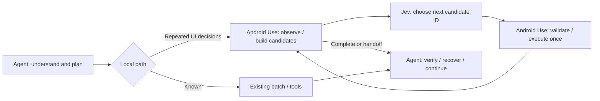

# Agent + Jev decision integration (experimental, available since v0.4.0)

**English** · [简体中文](jev.zh-CN.md) · [Project home](../README.md)

`aua_execute_goal` runs a bounded local goal through TypeSafe Jev. All original MCP tools and arguments remain available. It is disabled by default and **included in the v0.4.0 ZIP**; v0.3.0 users must update.

Inspired by [browser-use/jev-ultrafast](https://github.com/browser-use/jev-ultrafast), this independent Android implementation observes accessibility trees, builds code-owned action candidates, asks Jev to select an ID, executes it once, then observes again. It does not install the browser project or need a text-generating model at runtime.

## Agent + Jev

Routing prioritizes end-to-end completion speed, success rate and fewer host-model round trips. Jev token cost is treated as secondary telemetry, not a routing constraint. Delegate coherent local decision loops and reuse safe returned observations; keep host planning, recovery and business verification.

Your existing host Agent understands the request, plans subgoals, composes exact text, opens the intended app, and verifies business outcomes. It can delegate repeated **next-action decisions** inside a short local goal to `aua_execute_goal`. Android Use observes the UI and creates candidates; Jev returns a candidate ID and probabilities; Android Use validates and executes the selected action once. On completion or handoff, control returns to the same Agent. Long tasks use several subgoals.



Use ordinary tools for a known path; use Jev where the Agent would otherwise read the tree and decide repeatedly. The intended efficiency comparison is **Agent-only vs the same Agent + Jev**, including planning, handoff/recovery and final verification. The earlier deterministic-tools comparison measures execution overhead only. Normal hybrid use needs only your existing Agent and the TypeSafe key; `TEXT_MODEL_*` is optional configuration for a separate API-based benchmark, not an installation requirement.

[Latest performance comparison and raw records →](benchmarks/optimizations-v4.md). Run `scripts/benchmark_agent.py` with the same `uv run --env-file .env --frozen python` prefix, `--serial <device>` and `--repeats 3`: the current Agent chooses ordinary tools or Jev decisions, handles recovery and verifies results. The driver measures host waiting separately. Host token charges remain unknown when the host does not expose per-task billing.

## Configure

### Recommended: screen settings

Open the live phone view, click the settings gear, paste your TypeSafe API Key, and choose **验证并启用** (Verify & enable). This makes one fixed connection-test request without reading phone UI, then saves and enables the key for new tasks. You can test the saved connection, disable Jev, or remove the locally saved key in the same panel. The key field clears after saving and when closing the dialog.

Settings are shared by the local browser, native MCP App and later CLI/MCP calls. They take effect for **new tasks without restarting the server**; an in-progress bounded goal keeps the configuration it started with. The local file is `~/.local/share/android-use/jev.json` (or `ANDROID_USE_STATE_DIR/jev.json`), written atomically with POSIX mode `0600`. It is never included in packages or returned to the UI.

Explicit local enable/disable settings override `ANDROID_USE_JEV_ENABLED`. A saved local key takes priority over `TYPESAFE_API_KEY`; removing it leaves Jev disabled even if an environment key remains available. Provider/model overrides still come from the environment and are displayed in settings.

### Advanced: environment configuration

The UI route needs no manual `.env` edits. Existing environment-based setups remain supported.

Copy `.env.example` to `.env`, set `ANDROID_USE_JEV_ENABLED=1` and `TYPESAFE_API_KEY`. Keep the file private; it is ignored by Git. Never paste keys into chats or tool arguments. Start/verify the normal Android service, launch the intended app, and keep it unlocked. The goal executor does not start the phone service automatically.

Pass these variables to the MCP server process. A plugin or MCP host does **not automatically load** the repository's `.env`. Merge this source-based stdio configuration into your client's existing settings, replace the absolute paths, and reconnect:

```json
{
  "mcpServers": {
    "android-use": {
      "command": "uv",
      "args": ["run", "--env-file", "/absolute/path/android-use/.env", "--frozen", "--directory", "/absolute/path/android-use", "android-use-mcp"]
    }
  }
}
```

Alternatively inject environment variables through your host's secret manager. The default is pinned `jev-1.14.0` at `https://api.typesafe.ai/v1/systemone`. `TYPESAFE_MODEL` / `TYPESAFE_BASE_URL` override these. A custom URL receives the key: use a trusted provider only. HTTPS is required except for loopback test servers. No redirects, implicit paid-request retries or silent model fallback.

## Use

Call `aua_execute_goal` with observed package/selector facts:

```json
{
  "goal": "Open Profile, set Name to Android helper, then Apply draft to save locally.",
  "package": "your.verified.app.package",
  "texts": ["Android helper"],
  "completion": {"text": "DRAFT=Android helper"},
  "max_steps": 8,
  "max_model_calls": 16,
  "timeout_seconds": 20.0
}
```

CLI supports the same JSON: `uv run --env-file .env --frozen android-use --serial <device> execute_goal '<JSON>'`.

`texts` is an allowlist of exact input values; Jev chooses a value, it cannot write prose. Default actions: `tap`, `swipe`, `type_text`, `wait`. Add `long_press` or `back` to `actions` explicitly when needed. Existing tools handle double taps, arbitrary dragging, launching apps, visual/custom controls and recovery. `execute_goal` cannot be nested in `batch`.

## Fewer reads and input decisions

Within each validation phase, screen-on and viewport checks share one sampled `deviceInfo` response. That response is never cached across inference, actions or waits. The tree is still bracketed by fresh context checks; the selected decision is checked again after inference and before execution.

`input_macros` defaults to `true`. When both `tap` and `type_text` are allowed, a visible unfocused EditText with a unique resource ID or content description can offer a `focus_type_text` candidate: **focus → set one exact supplied value → native getText verification**. Jev selects this as one decision; Android Use executes at most two native mutations. The binding must be unique across the entire hierarchy, including offscreen nodes. Newlines, passwords and implicit submission are excluded. Fields without a stable binding retain the existing primitive candidates.

Before writing, focus, identity, geometry and layout must still match. Unexpected dialogs, overlays, scope changes, locks or pause stop the macro. After writing, the same bound field may resize due to text/font metrics; identity, visibility, focus and exact native readback remain required. No coordinate action follows that resize. An exposed IME still causes a handoff. The synthetic fixture suppresses IME opening, so its results do not establish support for all keyboard layouts.

`steps[].substeps` records focus and input separately, including acknowledged writes and verification. A macro may return `partial` after focus, or `uncertain` after a write/read failure. Never replay it automatically. `handoff.completed_actions` counts executed native leaf actions, not macro candidates. `max_steps` counts selected candidates: one input macro can contain two native actions. Set `"input_macros": false` to retain separate focus/input decisions for compatibility or comparison. Ordinary MCP tools and batch behavior are unchanged.

[Paired baseline / sampling-only / sampling + macro measurements →](benchmarks/optimizations-v4.md)

## Results and boundaries

| Result | Meaning |
| --- | --- |
| `status=completed`, `verified=true` | Caller-supplied completion selector met in a current nonempty app-owned tree. A selector is only as meaningful as the condition chosen. |
| `status=handoff` | Return control to the host agent. Even `ok=true` is not business success. |
| Model `DONE` | Without a completion predicate, unverified handoff. An unmet predicate also cannot count as success. |
| `steps` | Attempted candidates with executed/partial/uncertain states; macro `substeps` preserve each native mutation and input verification. Never automatically replay. |
| `roles` / `decisions` | Planner/decision/executor ownership and candidate decision audit, including stale or consumed decisions. |
| `handoff` | Stop reason, acknowledged action count, uncertain step indices and recommended user-authentication or observe/replan handoff. |
| `observation` | Default `observe=tree` reuses the last checked tree when safe. `observe=none` suppresses it. Errors involving authentication, transport or scope never return an old tree. |
| `metrics` | Calls, actual models, tokens, model/device times, stale decisions and estimated USD. |

Default gates require selected probability ≥0.65 and margin ≥0.1. These experimental gates are not calibrated correctness guarantees; TypeSafe's confidence statistic is not task accuracy.

After inference, the executor rereads foreground/activity/display and a visible app-tree semantic fingerprint (excluding global XML traversal/parent indices, preserving node semantics, geometry, state, ordering and foreground context). Changed state discards the decision within the call budget. It stops on scope changes, interactive foreign overlays (including exposed keyboards), passwords, lock/off screens, pause, three unchanged steps, action/call limits or deadline. In-flight ADB can exceed the budget. Tree checks and input are not atomic and cannot prove a target is unobstructed. The host must verify final business outcomes.

Only visible app-owned nodes generate actions. At most 200 candidates, a 120-node UI summary and a 32 KB UTF-8 state/candidate budget are used; oversized contexts hand off. Newline input is not offered because editors may submit it. Password screens stop before inference. Experimental TypeSafe image support is not enabled.

Opting in sends the goal, visible UI text, candidate descriptions, supplied input values and short action history to TypeSafe. Avoid sensitive inputs. Returned traces omit raw UI and input values. Original local tools work without cloud keys.

For known versions, cost uses [TypeSafe's published price](https://docs.typesafe.ai/models): $0.042 per million input tokens, output free. This is an estimate, not an invoice. Unknown models, missing usage or failed requests yield `estimated_cost_usd=null`, plus a partial lower bound and `unpriced_calls`, rather than counting unknown charges as zero.

## Reproduce the comparison

Requires an unlocked, authorized emulator/device, JDK, Android SDK with a stable API 28+ platform and Build Tools, and a running control service. The script installs a permission-free synthetic fixture, refuses to replace an existing fixture, uninstalls it in `finally`, and restores the previous activity.

```bash
uv run --frozen android-use --serial emulator-5554 setup '{"action":"status"}'
# Only if the service is absent, start once; then verify READY.
uv run --frozen android-use --serial emulator-5554 setup '{"action":"start"}'
uv run --frozen android-use --serial emulator-5554 ready
uv run --env-file .env --frozen python scripts/benchmark_executor.py \
  --serial emulator-5554 --repeats 3
```

Arms: existing deterministic tools/batches (execution floor), Jev, and an optional OpenAI-compatible stepwise text model. The two model arms use the same state, candidates, goals and budgets. Set `TEXT_MODEL_BASE_URL` (including `/v1` where required), `TEXT_MODEL`, `TEXT_MODEL_API_KEY`. Optional verified `TEXT_MODEL_INPUT_USD_PER_MILLION` / `TEXT_MODEL_OUTPUT_USD_PER_MILLION` enable baseline cost estimates. Missing config is recorded as skipped, never fabricated. The generative arm has no Jev Choice probabilities; it validates candidate IDs and shares the other execution bounds.

Four tasks cover navigation/delayed results, Chinese draft input, nested scrolling/selection and long press. Order rotates across repeats; each run resets the app. End-to-end timing includes inference, actions, observations and independent final verification; build/install/reset/cleanup are excluded. Failures and handoffs count toward latency and cost per success. The fixture disables soft-keyboard opening to isolate native setText. These tasks do not establish performance on production apps, visual reasoning or general Android success.

Output defaults to ignored `test-results/jev-benchmark.json`. [Measured results and limits →](benchmarks/jev-emulator.md)

For actual stdio MCP plus the existing gesture regression, run `uv run --env-file .env --frozen python scripts/accept_device.py --serial <device> --jev` after setting the opt-in variable. This installs/removes the same temporary fixture and also exercises the goal tool through a separate MCP server process.

Primary references: [System One](https://docs.typesafe.ai/api/system-one), [Choice](https://docs.typesafe.ai/primitives/choice), [confidence](https://docs.typesafe.ai/confidence).
