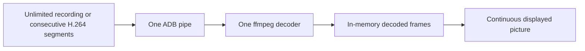

# Continuous live preview (v0.5.1)

Included in v0.5.1: remove the unconditional 170-second reconnect. The older v0.5.0 ZIP does not contain this fix.

## Capture and display

- Probe the selected device's own `screenrecord --help`, including stderr. When it explicitly documents `0` as removing the time limit, use `--time-limit 0`. Do not infer support from the Android version or manufacturer.
- Otherwise, keep one device-side wrapper running consecutive bounded recordings. Their H.264 segments share **one ADB pipe and one ffmpeg decoder**. Normal segment boundaries do not tear down the host pipeline or emit a disconnect state. No additional runtime or phone APK is required for preview.
- Decode without a multi-frame input thread queue and sample by actual decoder arrival time. Raw H.264's synthetic timestamps can otherwise discard too many sparse screen updates. Only real decoded pictures are published; no duplicate video frames are manufactured to disguise a stall.
- For a short encoder recovery, rotation or viewer return, keep the last decoded picture visible without a blocking overlay. Buffering is a distinct internal state: phone actions and copying are disabled until a fresh frame arrives. A small status label can indicate buffering; routine continuous capture needs no reconnect notification.
- Recovery cannot retain a picture indefinitely: after five seconds without recovery, clear it and show unavailability while continuing retries. Transport failures with unknown device state, disconnection, lock and authentication pause still clear the picture. A disconnected device cannot supply fresh video, and this feature does not conceal that fact.

Older recording builds can still have a short motion pause during encoder turnover even though the display does not flash black. The goal is to remove routine reconnect disruption; it is not a guarantee of zero latency or uninterrupted motion on every device/codec.



Capture keeps the original view-lease behavior: after no viewer renews the lease for five seconds, capture stops. No screenshot or UI-tree polling is added. A failed capture that exits immediately cannot spin in an unbounded device-side spawn loop; the host handles failures with bounded backoff. Process cleanup matches private PID records and kernel start times, and stopping the wrapper prevents it launching another segment. A closed hub rechecks its state after an in-flight health probe so it cannot restart capture after close.

## Updating and diagnostics

The wire protocol remains compatible with existing v0.5.0 clients. A separate implementation revision upgrades an authenticated older daemon; a client reuses a newer implementation of the same wire protocol instead of downgrading it. Reload the MCP process after updating code. Reopening preview then upgrades the video daemon as needed.

Display geometry and optional label reads are separate from the required lock-state check. If display metadata fails after capture has started, video continues while `interaction_ready=false` disables preview controls. The daemon also rejects coordinate actions in this state, including from older clients that ignore the new field. Initial capture still requires valid geometry. Unknown lock state continues to stop capture and clear the picture.

The frame response's `video` diagnostics include recording mode/limit, pipeline starts, lock-state health failures, display-metadata failures, last failure stage and stream failures. They are separate from device-control readiness. A preview failure does not justify repeating a phone business action.

[AOSP's documented zero-limit handling](https://android.googlesource.com/platform/frameworks/av/+/b675cea85b508d7f60f1344e5a24c3db7a5b8d0f/cmds/screenrecord/screenrecord.cpp) is the capability used here; unsupported devices retain the bounded-segment path.

## Reproduce on an isolated emulator

This opt-in acceptance rejects physical serials and verifies `ro.kernel.qemu=1`. It builds a permission-free moving-counter fixture, uses an isolated state directory, and removes the fixture afterward. It never selects a physical phone, uses private accounts, requests a Jev key, or saves screen video.

```bash
uv run --frozen python scripts/accept_preview.py \
  --serial emulator-5564 --seconds 190 --legacy-seconds 25 \
  --output test-results/preview-continuity.json
```

For a controlled display-metadata fault, add `--inject-display-failure` (a 15-second native phase is sufficient). It rejects only display-size/rotation queries during seconds 5–8; lock-state checks remain real. Acceptance requires pictures to continue with controls blocked, then restore controls after metadata recovers.

The SDK/JDK/build-tools used by `scripts/accept_device.py` are required only for this acceptance fixture. The first phase crosses the former 170-second boundary. The second forces a two-second limit, exercising many legacy segment transitions quickly. The encoder-PID observer runs separately from frame sampling; publisher arrival gaps and consumer sampling gaps are recorded separately to avoid confusing diagnostic ADB latency with capture interruption.

The moving fixture also logs its own UI-callback gaps above 500 ms; the harness reads only that fixture PID and tag. This is diagnostic evidence of source-side scheduling stalls, not proof that every capture gap has the same cause. Record the emulator renderer: the original AVD had GPU emulation disabled; the final acceptance explicitly uses `-gpu host` without changing the saved AVD configuration.

[Acceptance results and retained failed trials](benchmarks/preview-continuity.json) accompany the implementation. Browser regression checks verify no blocking overlay or image removal during bounded healthy buffering, fresh-frame recovery, disabled stale-frame interaction, persistent-failure display and authentication clearing. Emulator and browser regressions have separate coverage from the subsequently authorized physical-device trial below.

## Current validation and remaining limit

The source passes **289 Python tests and 19 browser tests**, including authentication clearing and the daemon-upgrade compatibility checks. The uninstrumented host-GPU emulator run measured:

| Path | Duration | ADB / decoder / observed encoders | Longest sampled picture gap | Motion-gap target |
| --- | --- | --- | --- | --- |
| Native unlimited | 190.027 s | 1 / 1 / 1 | 4.147 s | Failed the <2 s target |
| Forced 2-second segments | 25.024 s | 1 / 1 / 11 | 1.329 s | Passed |

A separate 15-second fault-injection run passed: three display-query failures preserved one ADB/decoder/encoder, delivered 20 pictures with controls blocked, then restored controls; its maximum sampled gap was 0.684 seconds. This targeted recovery result does not replace the failed long-run motion target.

Both paths reported zero lock-state, metadata and stream failures in the long uninstrumented run. The uninterrupted encoder crossed the former 170-second cutoff, and legacy encoder changes did not rebuild the ADB connection or decoder. Nevertheless, one native capture pause still exceeded the motion-gap target after the metadata fix, so the full continuity acceptance command returned a failure. Earlier failures are retained too. These results verify removal of the routine reconnect and the bounded display behavior, not universally imperceptible motion. This fix ships in v0.5.1. The acceptance temporarily used source without replacing the installed v0.5.0 plugin.

## Authorized physical-device trial (2026-11-04)

A subsequent authorized trial used an Android 16 device (model `25019PNF3C`), a permission-free moving-counter fixture and the source preview HTTP service. The fixture kept its own foreground window awake without changing system timeout settings. Capture shared the real device authentication-pause path; lock or foreground takeover aborted the test. No screen pixels or personal App content were saved in the acceptance report.

| Phase | Duration | Distinct pictures | ADB / decoder / encoders | Maximum consumer / publisher gap | Result |
| --- | --- | --- | --- | --- | --- |
| Native unlimited | 190.187 s | 1,198 | 1 / 1 / 1 | 1.422 / 1.146 s | Passed |
| Forced 2-second segments | 25.054 s | 154 | 1 / 1 / 12 | 0.723 / 0.732 s | Raw harness failed on seeded transition state |

The native phase had zero health/metadata/stream failures and zero offline responses after its first picture. Its first frame took 3.043 seconds. Three browser inspections showed Live, a hidden blocking overlay and advancing frame sequences. These were point samples, not a continuous UI-state recording; the limited network sample was truncated and is not evidence of zero frontend failures for the full run.

Before the compatibility phase the local controller deliberately assigned `video_stream_ended` while replacing the unlimited pipeline with the forced-segment pipeline. The harness counted that initial seeded state as an error. The phase itself observed zero stream failures/offline responses and one ADB/decoder across 12 encoders, but its original failed result is retained rather than relabeled as a clean full-suite pass. [Sanitized physical records and interpretation](benchmarks/preview-continuity-physical.json).

The fixture was uninstalled, the original foreground restored and the installed v0.5.0 preview service restored afterward. The acceptance did not replace installed plugin files; the fix is distributed in v0.5.1. The earlier 4.147-second emulator failure remains unresolved; the physical native success does not establish universal latency or justify deleting earlier failures.

## 中文

支持取消时限的系统不再每 170 秒重启录屏；旧系统分段仍共用一条 ADB 管道与一个解码器。短暂恢复时保留画面，不弹遮罩，期间禁用旧画面上的操作；长故障、连接状态未知、锁屏或认证接管继续清屏。旧编码器换段可能短暂停顿，不能承诺所有设备和断网情形都毫无停顿。

本修复纳入 v0.5.1。模拟器验收与真机覆盖分开报告；随后获准的真机结果见上节。官方目录提交的身份认证与本地 MCP 准入材料属于另一个工作项，不包含在本次修复提交中。

源码通过 289 项 Python 测试、19 项界面测试。原生连续录屏长测跨过 170 秒边界，始终只有一个编码器、一条连接与一个解码器；旧系统强制换段观察到 11 个编码进程，连接和解码器各保持一个。但原生长测出现一次约 4.1 秒的画面停顿，未通过小于 2 秒的画面间隔目标，不能宣称所有场景均已完全无感。该模拟器停顿仍待进一步定位。随后 Android 16 真机连续 190 秒测试通过，始终一个编码器/连接/解码器，最长采样间隔 1.422 秒；兼容路径的原始失败记录包含人为注入的换模式恢复状态，已单独说明。测试页已卸载、原页面和 v0.5.0 预览服务已恢复，未替换本机插件。
