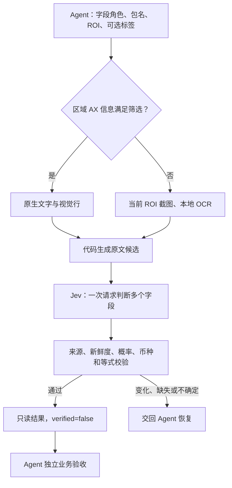

# 按页面能力路由：Android Use + Agent + Jev

**状态：A0 只读自动 OCR 已实现，源码尚未发布。** 精简上下文、结构化操作/目标头、原生动作效果等待、金额解析与只读 AX/OCR 字段判断已接入。自动视觉定位、OCR 点击、视觉等待和自动流程恢复仍属后续方案。

[参数与平台要求](jev.zh-CN.md#自动只读-ocr源码更新尚未发布) · [本轮真机记录及失败](benchmarks/real-app-ocr-v6.md)

本轮已落实两项评审问题：动作 ACK 后缺少效果等待、可能重复点击；金额规范化丢失全角负号或拆开千位金额。本页同时收紧了观测凭据和未来视觉动作的边界。

## 目标与分工

按端到端速度、成功率和减少 Agent 往返优化；Jev 费用只作遥测。

- Agent 理解用户、规划跨 App 子任务、提供准确文本、选择当前 ROI、处理恢复，独立验收最终业务结果。
- Android Use 生成有来源的候选，校验设备/范围/期限，执行一次动作；只读字段与动作执行分开。
- Jev 在有限候选中判断操作、目标或字段角色，不生成命令、坐标或缺失金额。
- 确定性代码负责坐标映射、原文金额规范化、Decimal 等式、候选与证据检查、记录及交回。

## 当前实现：A0 只读观测

路由以**当前页面与 ROI**为单位，不按 App 技术栈贴标签。默认 `source=auto`：区域内有文字、包含所有 `expected_labels` 子串，且 money 请求有金额候选时走 AX；否则在首个模型请求前走 OCR。它不是完整任务理解器：少量无关数字也可能满足初筛，因此应给出关键标签和清晰字段角色，必要时显式 `source=screen_ocr`。`source=tree` 永不 OCR，AX 健康时不固定增加截图开销。

内置 OCR 使用 macOS Vision，依赖 Xcode Command Line Tools；Linux/Windows 尚未实现 OCR 提供器，返回 `ocr_unavailable`，保留原有 AX 工具与 Agent 文本兜底。接口输出文字、分数、归一化块框，代码转成设备像素框并组合视觉行。没有划线样式识别，`style=unknown`，不能仅凭 OCR 或位置证明现价。

截图仅在本机处理；ROI 识别文字和字段问题会发给 TypeSafe。调用方可显式提供最多 8 个 mask，必须完整落在 ROI，面积总和不超过 20%。mask 在 OCR 和哈希前涂白，既不提供证据，也不参与变化判断；不能遮掉业务价格、弹窗或结果。不要自动猜测哪些变化可以忽略。

证据包括 ROI、截图/视口尺寸、采集时间、像素摘要、mask、OCR 提供器版本和候选块框。推理前后重查同一前台/Activity/视口与暂停、锁屏、可检测认证；推理后再次截图，比对 mask 外**精确像素哈希**，变化就拒绝全部判断。没有相似度容差，动画可能导致保守失败。画面不变仅证明该 ROI 像素未变，不能证明全屏没有自绘弹窗或所有认证均已识别。

`frame.id` 目前仅是只读诊断凭据，**不是**动作可使用的 `observation_id`，也没有绑定任何点击授权。Agent 提供的 `evidence_text` 始终标为来源未验证、新鲜度 `unchecked`，不能混传设备 source、ROI 或 mask；它不因前台一致就变成设备 OCR。

Jev 的 probability/margin、OCR 分数、金额等式和业务验收分开处理。OCR 分数不等于正确率，默认只作遥测；money/text 候选可由调用方设置已验证的阈值，choice 分类没有单候选 OCR 分数。`source_verified_on_device` 仅证明来源；`verified` 始终为 false，Agent 必须独立核对业务结果。

## 已修复：动作确认与金额规范化

动作被执行器确认后，默认等待最多 1 秒（`effect_timeout_seconds=0.1–3`，受总期限约束）观察非空语义变化或完成条件，不再请求第二个决定或重发动作。过渡空树只继续观察；布局几何变化本身不算效果。未观察到效果交回 `uncertain_effect`，已 ACK 的步骤仍记录 executed；回到同一已消费状态/动作则交回 `duplicate_action`。等待和有界列表滑动保留原有无进展限制。该记录不跨调用去重，Agent 不能重新提交整个目标。

字段先找原文，再由 Jev 判角色；代码保留原文，规范化全角/Unicode 负号、千位逗号和点号小数，用 Decimal 解析。明确支持的币种和格式见参数文档，不声称支持全部地区金额。`¥` / `$` 无法单独确定币种，求和需声明一致币种；缺项不当作零，负优惠放 add，subtract 只放正的扣减幅度。等式只检查调用方声明的费用关系，不会枚举等式并把数值凑齐当作语义正确。

编译、识别、推理与设备读取共享总期限（默认 20、最大 60 秒）；编译最多剩余 15 秒、OCR 5 秒、Jev 8 秒。设备 RPC 保留已有超时，进行中操作可能越过剩余预算。超时丢弃判断、保留耗时与模型使用记录，不自动无限升级或重试。

## 下一阶段 A1：可定位文字与视觉动作

在只读证据稳定后，再加入 OCR 文字锚点和受约束视觉候选：

1. 优先使用可靠 AX 绑定；OCR 只补充缺失语义。重复文字需要行上下文、唯一性和邻近锚点，不能直接取第一个框。
2. 复用并扩展现有 Runtime 观测凭据，绑定设备、前台/Activity/视口、页面阶段、目标 ROI 与邻近布局、截图缩放和允许动作；不能另造可绕过原 guard 的通用点击 ID。
3. 点击前重新读取当前截图与完整上下文，检查目标框和周边结构、可检测遮挡、认证与授权；全屏哈希易受时钟干扰，单个紧框又不能证明周围无遮挡。候选失效就丢弃，不猜坐标。
4. **先实现视觉动作效果等待，再开放视觉点击。** 要求下一步可用内容和有界稳定窗口，加载骨架不算完成；区分未消费、已执行、效果不明。动作只消费一次，超时只观察并交回。
5. 用真实样本校准相似度和 OCR 阈值。支付、发送、删除等授权不因视觉识别而自动扩大；自绘编辑器输入仍需独立设计，不安装或切换输入法。

Jev Images/Box 仍作为独立实验开关的后续定位建议，也可用 Agent 自带视觉能力恢复；不会给所有页面固定增加第二个大模型。Box 结果不能直接执行，必须通过上述范围、唯一性、新鲜度和效果检查。[Images](https://docs.typesafe.ai/images) · [Box](https://docs.typesafe.ai/primitives/box)

## 验收与后续对比

| 阶段 | 当前状态 | 验证边界 |
| --- | --- | --- |
| A0 只读自动 OCR | 已实现，源码未发布 | 美团 AX/OCR 与淘宝自动 OCR 开发真机验收；保留失败与清理记录 |
| 两项评审修复 | 已实现 | 延迟渲染、空树过渡、认证/范围中断、防重复动作、符号/币种/求和离线回归；后续守卫调整未再做真机复验 |
| A1 文字锚点、视觉等待和点击 | 未实现 | 需覆盖重名、遮挡、旋转、缩放、过期框、不重放、复杂输入 |
| A2 局部流程恢复 | 未实现 | 同起点完整美团/淘宝流程及跨版本冷/热启动，限制恢复次数 |

本轮先完成能力与错误边界验收。代码、ROI 和提示在开发中变化，不从试跑推算生产成功率；两个不同饮品的订单金额不证明最低价。用户要求停止手机操作后，只继续离线测试。

后续正式性能对比轮换 Agent-only、Agent+Jev AX、Agent+Jev 混合视觉顺序，重置临时购物车、同起点同目标，保留失败与恢复。报告完整业务成功率、端到端中位数/P95、Agent 往返、设备读取/动作、Jev/OCR 耗时、错误点击、过期决定和人工接管；不把官方其他场景的倍数移植到本项目。未测试的厂商、系统、App 版本与 OCR 提供器组合单独标注。
