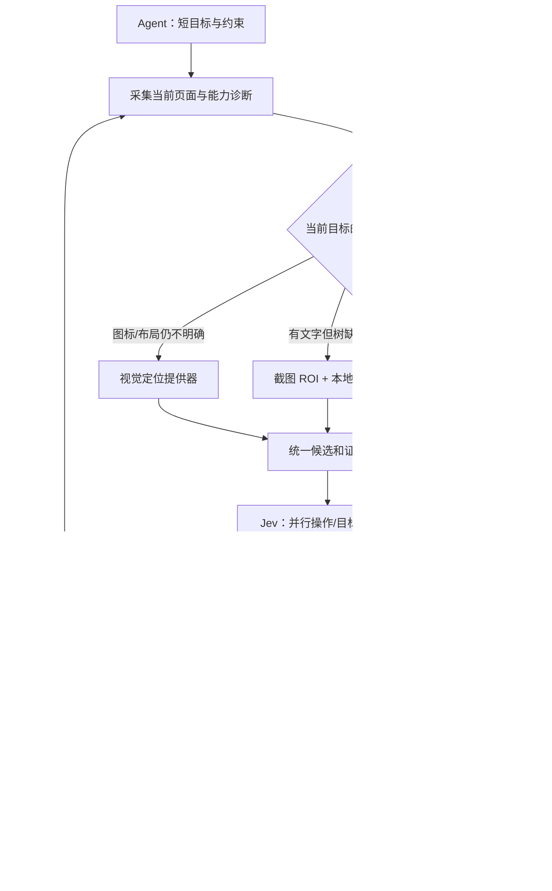

# 按页面能力路由：Android Use + Agent + Jev

**状态：设计方案。** 当前已实现精简上下文、结构化操作/目标判断、只读字段判断、区域文本校验与金额校验。下面的自动 OCR、视觉定位、视觉点击和稳定画面等待尚未实现。不要将本方案视为现有产品能力。

[当前实现与使用方式](jev.zh-CN.md) · [本轮真机记录](benchmarks/real-app-jev-v5.md)

## 目标与分工

优化端到端完成速度、成功率和 Agent 往返次数。模型单次推理速度只是其中一项，Jev 费用不作为路由门槛。

- Agent：理解用户意图、规划跨 App 子任务、提供准确输入文本、处理恢复，验收最终业务结果。
- Android Use：选择观测路径，生成有来源的候选，执行一次动作，检查新页面并管理期限与接管。
- Jev：针对当前状态选择操作、目标和有限集合的字段答案；不生成自由文本或执行命令。
- 确定性代码：坐标映射、金额解析、排序、优惠条件计算、权限范围、候选校验及执行记录。

## 1. 按任务需要判断页面能力

不能用“节点非空”或“App 是否原生”作为唯一判断。Android 自绘 View 可以只暴露空容器；跨平台控件如果正确提供语义也可以正常使用。同一个 App 的登录页、原生列表和小程序必须分别诊断。[Android 自绘控件文档](https://developer.android.com/guide/topics/ui/accessibility/views/custom-views)、[Flutter 无障碍技术](https://docs.flutter.dev/ui/accessibility/assistive-technologies)

诊断信号包括：可见文本数量、带语义的可操作控件比例、EditText 是否可用、是否只有一个全屏容器，以及当前目标对应的标签/金额是否存在。树与截图的信息差需要在首次诊断或失败时采样；不为每个健康原生页面固定增加截图请求。

路由结果：

| 页面能力 | 观测与执行路径 |
| --- | --- |
| 控件和目标字段均可用 | AX 语义候选 → Jev → 原生执行 |
| 控件可用，价格/样式缺失 | AX 操作 + OCR/视觉字段补充 |
| 文本可见，控件树缺失 | OCR 文字/边界框 → 候选；可验证目标才允许视觉点击 |
| 无文字图标、复杂布局 | 视觉提供器提出目标，代码校验后生成候选 |
| 加载、遮挡、目标不明 | 有界等待或交回 Agent；不猜坐标 |

诊断可在同一 Activity 的语义页面阶段内短暂复用。切换 App、Activity、横竖屏、主要内容或连续无进展后失效；不能永久给整个包名贴“只用 OCR”的标签。

## 2. 统一候选与证据，不做两套执行器

每个候选包含：短 ID、来源 `ax/ocr/vision`、可选原生绑定、准确文字、角色、设备像素边界框、允许操作和观测凭据。AX 与 OCR 重叠的同一目标进行合并；有可靠原生绑定时优先原生执行。原文、控件身份和行关系保留在本地，模型只接收当前子目标所需的精简表示。

观测凭据包含设备/前台/Activity/视口、截图尺寸与缩放、采集时间、屏幕阶段 ID 和相关 ROI 的证据摘要。ID 只在该次观测内有效，历史坐标不能直接复用。

Jev 在一次请求中并行判断操作及各操作的目标，只消费选中操作对应的目标头。相同观测下的字段分类也可以批量判断；会依赖下一页面的问题必须等下一次观测，不能提前编出整条动作链。[官方 fan-out](https://docs.typesafe.ai/patterns/fan-out)

## 3. 视觉观测与模型选择

先做一个可插拔本地 OCR 接口，输出文字、置信信息、边界框及视觉行。优先使用目标 ROI，按需扩大区域；保留原价/现价的位置及可见样式证据，不能让 OCR 丢掉划线、负号或单位后就直接认定金额角色。各平台的 OCR 实现需独立验收；不可默认用户电脑都有 macOS Vision。

纯文字和可定位按钮可使用 OCR 候选加 Jev Choice。无文字图标或文字定位不足时，使用视觉提供器。Jev 1.14 支持 Images/Box，但官方仍标为实验能力、需要专门请求头，因此应默认关闭、独立开关验收；还应允许 Agent 自有视觉模型作为后备。Box 的输出是归一化边界框，只是定位建议，必须经过代码边界与新鲜度检查后才能成为动作候选。[Images](https://docs.typesafe.ai/images)、[Box](https://docs.typesafe.ai/primitives/box)

不要给所有页面固定增加第二个大模型。按“AX → OCR → 必要时视觉提供器 → Agent”逐级补足信息，并在找不到可靠证据时停止升级循环。

## 4. 视觉点击和输入的执行边界

视觉目标点击前必须重新检查：同一前台/Activity/视口、目标仍在有效 ROI 内、最新相关画面与原观测一致，以及没有已检测到的菜单、弹窗或外部窗口遮挡。只比较全屏哈希会被时钟、轮播干扰；只检查 AX 又看不到自绘变化，因此需要目标 ROI 与邻近布局的联合校验。具体相似度阈值用设备样本校准，不能把相似度当成绝对无遮挡证明。

每个决定最多消费一次；变化后丢弃决定，重新生成候选。点击已确认但后置条件超时，只观察当前状态，不重复点击。支付、发送和删除不会因视觉识别而自动获得授权。

输入单独处理：OCR 只能找到输入框，不能让自绘编辑器自动支持 Unicode。优先已有原生绑定、精确 setText 和原生回读；否则交回 Agent/用户。新的键盘、剪贴板或输入法方案需要独立设计和授权，不能悄悄安装或切换输入法。

## 5. 等待与业务验证

动作后等待“下一步有用状态”：原生页面使用选择器条件；自绘页面使用 ROI 文字/视觉变化与有界稳定检测。稳定窗口忽略已知无关区域，并设时间和采样上限；加载骨架不能作为完成证据。

字段采用“代码寻找原文候选 → Jev 判断角色 → 代码解析与校验”。缺失值保留 NONE。比价至少检查：同一配送口径、商品/规格、起送门槛、包装费、当前配送费、已有优惠和需购买的新券包。金额检查使用 Decimal；只有明确列出的费用参与等式，不能默认缺失费用为零，也不能混用币种。划线原价误判、优惠叠加错误等冲突交回 Agent。

代码等式相符只证明数字一致。最终仍由 Agent 对照新的结算画面确认；不能用同一份错误 OCR 的分类结果自证业务成功。

## 6. 分阶段实施与验收

| 阶段 | 交付 | 验收重点 |
| --- | --- | --- |
| 当前代码 | 上下文压缩、操作/目标头、只读字段与金额校验 | 本轮自动化测试与美团/淘宝结算记录；保留失败 |
| 下一阶段 A | 页面能力诊断、自动 OCR、统一只读屏幕证据 | 原生、混合、自绘页面；原价/现价、负号、中文、加载态 |
| 下一阶段 B | 带凭据的视觉候选和视觉点击 | 过期画面、弹窗遮挡、缩放/旋转、重复文本；不重放动作 |
| 下一阶段 C | 视觉等待、局部流程自动恢复 | 美团/淘宝从相同起点搜索到结算，跨版本、冷/热启动 |

真实对比使用 Agent-only、Agent+Jev AX、Agent+Jev 混合视觉三个分组，轮换顺序并重置临时购物车，保留失败与恢复。分别记录：完整业务成功率、端到端中位数/P95、Agent 往返、设备读取/动作次数、Jev 请求与本地交回、OCR/视觉耗时、错误点击、过期决定与人工接管。开发期间修改代码或提示的试跑不得混作正式成功率；官方其他任务的“10 倍”不能套到本项目。

上线前要求：原有测试保持通过，新增异常回归通过，两个真实 App 在当前设备上完成并由 Agent 独立验收；性能改善必须来自同条件对比。厂商、系统、App 版本或 OCR 提供器尚未测试的组合明确标记。
